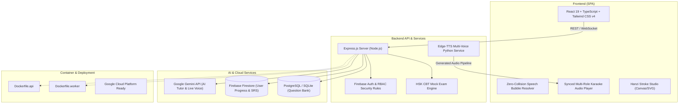

# 🇨🇳 Minnese - Nền tảng Học tiếng Trung & Luyện thi HSK Thông minh Toàn diện

<div align="center">


**Nền tảng e-Learning tiếng Trung full-stack thế hệ mới chuẩn hóa New HSK 3.0 (HSK 1 → HSK 6).**  
Tích hợp giáo trình chuẩn BLCUP, thuật toán bóng thoại chống che mặt độc quyền trên mọi thiết bị, công nghệ phòng thu âm thanh phân vai độc lập (17 Neural Voices), gia sư AI tương tác thời gian thực (Google Gemini API), ngân hàng đề thi CBT và phòng luyện viết chữ Hán tương tác.

[](https://vitejs.dev/)
[](https://www.typescriptlang.org/)
[](https://react.dev/)
[](https://tailwindcss.com/)
[](https://www.docker.com/)
[](https://vitest.dev/)
[](https://playwright.dev/)
[](LICENSE)

[Tính năng nổi bật](#-tính-năng-nổi-bật) • [Kiến trúc hệ thống](#-kiến-trúc-hệ-thống) • [Công nghệ sử dụng](#-công-nghệ-sử-dụng) • [Cài đặt & Chạy](#-hướng-dẫn-cài-đặt--khởi-chạy) • [Kiểm thử & QA](#-kiểm-thử--chất-lượng-phần-mềm)

</div>

---

## 📖 Mục lục

- [🌟 Giới thiệu Tổng quan](#-giới-thiệu-tổng-quan)
- [✨ Tính năng Nổi bật](#-tính-năng-nổi-bật)
  - [1. Giáo trình Chuẩn Hóa New HSK 3.0 & Tranh Minh Họa 100% Bản Quyền](#1-giáo-trình-chuẩn-hóa-new-hsk-30--tranh-minh-họa-100-bản-quyền)
  - [2. Thuật toán Định vị Bóng thoại Thông minh (Zero-Face-Collision Algorithm)](#2-thuật-toán-định-vị-bóng-thoại-thông-minh-zero-face-collision-algorithm)
  - [3. Hệ thống Âm thanh Phân vai Độc lập & Đồng thanh (17 Neural Voice Personas)](#3-hệ-thống-âm-thanh-phân-vai-độc-lập--đồng-thanh-17-neural-voice-personas)
  - [4. Gia sư AI Luyện Khẩu ngữ Thời gian thực (Google Gemini API & Live Voice)](#4-gia-sư-ai-luyện-khẩu-ngữ-thời-gian-thực-google-gemini-api--live-voice)
  - [5. Ngân hàng Đề thi HSK CBT (QBank & Mock Exam Simulation)](#5-ngân-hàng-đề-thi-hsk-cbt-qbank--mock-exam-simulation)
  - [6. Xưởng Luyện viết Chữ Hán Tương tác (Hanzi Stroke Studio)](#6-xưởng-luyện-viết-chữ-hán-tương-tác-hanzi-stroke-studio)
  - [7. Thẻ Nhớ Lặp lại Ngắt quãng (SRS Spaced Repetition Flashcards)](#7-thẻ-nhớ-lặp-lại-ngắt-quãng-srs-spaced-repetition-flashcards)
  - [8. Phân quyền Người dùng & Quản trị Lớp học (RBAC & Class Code)](#8-phân-quyền-người-dùng--quản-trị-lớp-học-rbac--class-code)
- [🏗 Kiến trúc Hệ thống (System Architecture)](#-kiến-trúc-hệ-thống-system-architecture)
- [🛠 Công nghệ Sử dụng (Tech Stack)](#-công-nghệ-sử-dụng-tech-stack)
- [📂 Cấu trúc Thư mục Dự án](#-cấu-trúc-thư-mục-dự-án)
- [🚀 Hướng dẫn Cài đặt & Khởi chạy](#-hướng-dẫn-cài-đặt--khởi-chạy)
- [🧪 Kiểm thử & Chất lượng Phần mềm (Testing & QA)](#-kiểm-thử--chất-lượng-phần-mềm-testing--qa)
- [🐳 Đóng gói Docker & Triển khai Cloud](#-đóng-gói-docker--triển-khai-cloud)
- [📄 Giấy phép (License) & Tác giả](#-giấy-phép-license--tác-giả)

---

## 🌟 Giới thiệu Tổng quan

**Minnese** là giải pháp phần mềm giáo dục e-Learning hoàn chỉnh hỗ trợ tự học, giảng dạy và luyện thi chứng chỉ Hán ngữ tiêu chuẩn quốc tế **New HSK 3.0** từ cấp độ 1 đến cấp độ 6.

Khác với các ứng dụng học ngoại ngữ thông thường chỉ cung cấp từ vựng rời rạc hoặc phát âm máy móc đơn điệu, Minnese đem đến trải nghiệm **nhập vai tương tác như một bộ phim hoạt hình sư phạm**:
- Dàn nhân vật hư cấu đồng nhất xuyên suốt qua từng bài học với cá tính, phục trang và giọng đọc đặc trưng.
- 105 bài khóa đầy đủ bối cảnh văn hóa sống động tại Bắc Kinh.
- Tích hợp sâu trí tuệ nhân tạo để sửa phát âm, luyện phản xạ đối thoại hai chiều và phân tích lỗ hổng kiến thức sau mỗi đề thi thử.

---

## ✨ Tính năng Nổi bật

### 1. Giáo trình Chuẩn Hóa New HSK 3.0 & Tranh Minh Họa 100% Bản Quyền
- **105 bài khóa hoàn chỉnh** (HSK 1: 45 bài khóa / 15 bài học; HSK 2: 60 bài khóa / 15 bài học) biên soạn theo chuẩn sư phạm của Đại học Ngôn ngữ và Văn hóa Bắc Kinh (BLCUP).
- **Tranh minh họa gốc chất lượng cao**: Đầy đủ 105 tranh bối cảnh với hai chuẩn khung hình:
  - Khung tỷ lệ `4:3` (`aspect-[1024/765]`) cho các bài đối thoại cận cảnh, sinh hoạt gia đình, lớp học.
  - Khung tỷ lệ Widescreen `16:9` (`aspect-[1024/572]`) cho các đại cảnh trường đại học, sân bay, đường phố mùa đông.

### 2. Thuật toán Định vị Bóng thoại Thông minh (Zero-Face-Collision Algorithm)
- **Vấn đề giải quyết**: Khi hiển thị lời thoại truyện tranh lên tranh vẽ, chữ viết rất dễ đè lên mặt nhân vật hoặc bị tràn khung khi đổi kích thước màn hình.
- **Giải pháp kỹ thuật (`resolveSmartBubbleBox`)**:
  - Tự động quét và lập bản đồ tọa độ khuôn mặt (`face`), đỉnh đầu (`head`), tọa độ miệng (`mouthTarget`) và vạch ngăn màn hình (`splitScreenDividerX`).
  - Hệ thống tính toán không gian trống xung quanh đầu nhân vật, co giãn padding và font chữ linh hoạt theo biến số canvas-scale (`--bscale`).
  - **100% không che mặt**: Đã vượt qua kiểm chứng toán học trên **1,232 lượt đo lường** trên 4 nhóm thiết bị: Desktop (896px), Laptop (768px), Tablet (600px) và Smartphone (360px).
  - Đuôi bóng thoại vector SVG động tự co giãn độ dài (`10px–19px`) trỏ chính xác về phía miệng nhân vật đang phát âm.

### 3. Hệ thống Âm thanh Phân vai Độc lập & Đồng thanh (17 Neural Voice Personas)
- Khắc phục hoàn toàn tình trạng "một giọng đọc cho cả bài đối thoại". Từng nhân vật sở hữu một Voice Profile cố định được tổng hợp từ Microsoft Edge-TTS Studio:
  - 👩‍🏫 **Cô giáo Vương Nhất Phi**: `zh-CN-XiaoxiaoNeural` (chuẩn giọng sư phạm Bắc Kinh).
  - 👱‍♀️ **Bạch Gia Nguyệt (du học sinh)**: `zh-CN-XiaoyiNeural` (`-4Hz`, trong trẻo, lễ phép).
  - 👩‍🦰 **Annie (du học sinh phương Tây)**: `zh-CN-XiaoxiaoNeural` (`+16Hz`, hoạt bát, tươi vui).
  - 👩 **Vương Nhất Tuyết (chị gái)**: `zh-CN-XiaoxiaoNeural` (`-15Hz`, chín chắn, ấm áp).
  - 👨‍⚕️ **Bác sĩ Lưu Minh**: `zh-CN-YunjianNeural` (`-8Hz`, trầm ấm, tin cậy).
  - 👨‍🎓 **Lý Văn**: `zh-CN-YunxiNeural` (`-6Hz`, thanh lịch, trí thức).
  - 🧑‍🎓 **Trần Thiên Trung**: `zh-CN-YunxiNeural` (`+10Hz`, năng động, khỏe khoắn).
  - 👴 **Ông nội Lưu**: `zh-CN-YunjianNeural` (`-20Hz`, chậm rãi, phúc hậu).
- **Tính năng Hợp xướng Đồng thanh (Chorus Engine)**:
  - `zh-CN-Chorus-Students`: Hòa âm 4 giọng học sinh đồng thanh chào giáo viên trong lớp học.
  - `zh-CN-Chorus-JiayueAnnie`: Hòa âm stereo 2 giọng nữ khi Bạch Gia Nguyệt và Annie cùng đồng thanh cảm ơn hoặc chào hỏi.

### 4. Gia sư AI Luyện Khẩu ngữ Thời gian thực (Google Gemini API & Live Voice)
- Trợ lý ảo **Minnie AI** đóng vai trò gia sư bản xứ 1-on-1:
  - Luyện giao tiếp phản xạ tự nhiên theo chủ đề bài học vừa học.
  - Nhận diện lỗi phát âm, lỗi đặt sai trật tự từ tiếng Hán và khéo léo phản hồi kèm gợi ý chỉnh sửa ngữ pháp.
  - Hỗ trợ gọi thoại trực tiếp hai chiều (Live Voice Call) mô phỏng cuộc gọi thoại thực tế.

### 5. Ngân hàng Đề thi HSK CBT (QBank & Mock Exam Simulation)
- Mô phỏng 100% giao diện thi thực tế trên máy tính (**Computer-Based Test - CBT**) của kỳ thi HSK chính thức:
  - Đầy đủ 3 phân môn: **Nghe hiểu (Listening)**, **Đọc hiểu (Reading)** và **Viết (Writing)**.
  - Bộ đếm thời gian thực theo từng phần, tự động nộp bài khi hết giờ.
  - Thuật toán xáo trộn câu hỏi và đáp án thông minh từ Question Bank.
  - Chấm điểm tự động, xuất ma trận phân tích năng lực và tự động đưa các câu trả lời sai vào **Sổ tay Câu hỏi Sai (Wrong Answer Notebook)** để ôn tập lại.

### 6. Xưởng Luyện viết Chữ Hán Tương tác (Hanzi Stroke Studio)
- Sử dụng thư viện `hanzi-writer` kết hợp Canvas vẽ tay:
  - Minh họa quy tắc bút thuận (thứ tự nét bút) động từng nét chuẩn xác.
  - Tra cứu nghĩa chiết tự, âm Hán Việt, cấu trúc bộ thủ.
  - Chế độ "Luyện viết tự do" chấm điểm độ chính xác nét vẽ của người dùng ngay trên màn hình.

### 7. Thẻ Nhớ Lặp lại Ngắt quãng (SRS Spaced Repetition Flashcards)
- Áp dụng thuật toán **Spaced Repetition System (SRS)** tương tự Anki/SuperMemo.
- Đánh giá khả năng ghi nhớ qua 4 cấp độ: *Quên (Again) • Khó (Hard) • Tốt (Good) • Dễ (Easy)*.
- Tự động lên lịch ôn tập từ vựng ngắt quãng để tối ưu hóa quá trình chuyển từ vựng vào trí nhớ dài hạn.

### 8. Phân quyền Người dùng & Quản trị Lớp học (RBAC & Class Code)
- Hệ thống phân quyền chặt chẽ: `Admin`, `Teacher` và `Student`.
- Tính năng bảo vệ tài liệu độc quyền bằng **Mã lớp học (Class Code)**: Học viên cần nhập mã lớp do giáo viên cung cấp để mở khóa lộ trình học tập tương ứng.
- Phía quản trị viên hỗ trợ xem bảng thống kê tiến độ học viên, duyệt đề thi và chỉnh sửa bài tập.

---

## 🏗 Kiến trúc Hệ thống (System Architecture)



---

## 🛠 Công nghệ Sử dụng (Tech Stack)

| Lĩnh vực | Công nghệ | Mục đích sử dụng |
| :--- | :--- | :--- |
| **Frontend** | **React 19**, **TypeScript 5.8**, **Vite** | Xây dựng giao diện Single Page Application hiện đại, tải nhanh, type-safe |
| **Styling** | **Tailwind CSS v4**, **Lucide React** | Thiết kế giao diện phẳng, tối ưu hóa responsive đa thiết bị, dark/light theme |
| **Bút thuận Hán tự** | **Hanzi Writer**, **HTML5 Canvas** | Mô phỏng hoạt họa nét chữ Hán và bảng tương tác luyện viết ngón tay/chuột |
| **Xử lý Ngôn ngữ** | **Pinyin Pro**, **PapaParse**, **SheetJS** | Phân tách bính âm, phiên âm Hán ngữ, trích xuất dữ liệu từ điển và đề thi |
| **Backend API** | **Node.js**, **Express 4.x**, **ESBuild** | Xây dựng RESTful API tốc độ cao, đóng gói server bundle CJS |
| **Cơ sở Dữ liệu** | **Firebase Firestore**, **PostgreSQL**, **SQLite** | Quản lý tiến trình học tập, tài khoản người dùng, câu hỏi đề thi và thẻ SRS |
| **Xử lý Âm thanh** | **Python 3.10+**, **Edge-TTS**, **Mutagen** | Tự động hóa tạo 105 audio bài khóa và 500+ audio câu thoại phân vai chất lượng cao |
| **Trí tuệ Nhân tạo** | **Google Gemini API (`@google/genai`)** | Xây dựng gia sư ảo Minnie AI, hỗ trợ đàm thoại tương tác trực tiếp |
| **Testing & QA** | **Vitest**, **Playwright** | 378+ automated tests, kiểm thử hồi quy thuật toán va chạm và E2E |
| **DevOps** | **Docker**, **Google Cloud Platform (GCP)** | Đóng gói 2 container (`Dockerfile.api` & `Dockerfile.worker`), sẵn sàng deploy cloud |

---

## 📂 Cấu trúc Thư mục Dự án

```text
minnese/
├── public/
│   ├── audio/coursebook/       # Âm thanh 105 bài khóa full & hàng trăm câu thoại đơn lẻ
│   ├── textbook_art/           # 105 bức tranh minh họa HSK 1 & HSK 2 chất lượng cao
│   ├── minnie-mascot.png       # Linh vật trợ lý Minnie AI
│   └── favicon.svg             # Biểu tượng thương hiệu Minnese
├── src/
│   ├── components/
│   │   ├── Coursebook/         # Giao diện bài khóa, bong bóng thoại, karaoke audio
│   │   ├── LiveVoiceCall/      # Module gọi thoại tương tác với gia sư AI
│   │   ├── AITutor/            # Chat đàm thoại phản xạ kèm phân tích lỗi ngữ pháp
│   │   ├── Quizzes/            # Hệ thống thi thử HSK CBT (Listening, Reading, Writing)
│   │   ├── Flashcards/         # Luyện thẻ ghi nhớ lặp lại ngắt quãng (SRS)
│   │   ├── Writing/            # Xưởng luyện viết nét chữ Hán động (Hanzi Stroke Studio)
│   │   ├── Dictionary/         # Bộ tra cứu từ điển HSK thông minh, bộ thủ, chiết tự
│   │   └── Admin/              # Bảng điều khiển quản trị viên và giáo viên
│   ├── data/
│   │   ├── newHsk1BookData.ts  # Dữ liệu 15 bài học New HSK 1 (45 bài khóa)
│   │   ├── newHsk2BookData.ts  # Dữ liệu 15 bài học New HSK 2 (60 bài khóa)
│   │   ├── hsk1BubbleLayouts.ts# 105 cấu hình tọa độ bóng thoại và chốt an toàn khuôn mặt
│   │   └── coursebookAudioManifest.json # Ánh xạ file audio, thời gian, persona giọng đọc
│   ├── utils/                  # Xử lý âm thanh, pinyin, SRS algorithm, Firestore client
│   └── server/                 # Endpoint backend, API routes, QBank engine
├── scripts/                    # Bộ công cụ Python tự động hóa trích xuất tranh, sinh TTS
├── tests/                      # Bộ kiểm thử Vitest (378+ tests) và Playwright E2E
├── Dockerfile.api              # Docker image đóng gói dịch vụ máy chủ API
├── Dockerfile.worker           # Docker image đóng gói background worker xử lý dữ liệu
├── package.json                # Danh sách thư viện phụ thuộc và script vận hành
└── README.md                   # Tài liệu hướng dẫn dự án
```

---

## 🚀 Hướng dẫn Cài đặt & Khởi chạy

### 1. Yêu cầu Tiền đề
- **Node.js**: Phiên bản `18.x` trở lên (Khuyến nghị `20.x LTS`).
- **Python**: Phiên bản `3.10` trở lên (Dùng cho pipeline sinh âm thanh Edge-TTS).
- **Git** và trình duyệt web hiện đại (Chrome, Edge, Firefox, Safari).

### 2. Sao chép Mã nguồn & Cài đặt Thư viện
```bash
# Clone mã nguồn dự án
git clone https://github.com/NguyenNgocTu041105/Minnese-.git
cd Minnese-

# Cài đặt thư viện Node.js
npm install

# Cài đặt thư viện Python hỗ trợ xử lý âm thanh (Tùy chọn)
pip install edge-tts mutagen Pillow
```

### 3. Thiết lập Biến Môi trường (.env)
Tạo file `.env` tại thư mục gốc với các thông số cấu hình:
```env
PORT=8000
NODE_ENV=development
GEMINI_API_KEY=your_google_gemini_api_key_here
FIREBASE_API_KEY=your_firebase_api_key
FIREBASE_AUTH_DOMAIN=your_project.firebaseapp.com
FIREBASE_PROJECT_ID=your_project_id
```

### 4. Khởi chạy Ứng dụng
```bash
# Chạy chế độ Phát triển (Development với Hot-Reload)
npm run dev

# Đóng gói và chạy bản Production tối ưu hóa
npm run build
npm start
```
Mở trình duyệt và truy cập: `http://localhost:5173` (hoặc `http://localhost:8000`).

---

## 🧪 Kiểm thử & Chất lượng Phần mềm (Testing & QA)

Dự án áp dụng quy trình kiểm thử tự động nghiêm ngặt nhằm đảm bảo độ tin cậy cao nhất cho hệ thống giáo dục:

```bash
# Chạy toàn bộ 378+ test suites với Vitest
npm test

# Chạy kiểm thử E2E với Playwright
npm run test:e2e

# Chạy kiểm chứng ma trận không che mặt trên 105 bài khóa
npx tsx scripts/verify_hsk1_bubble_collision.ts
python scripts/verify_hsk2_all.py
```

**Kết quả kiểm thử đạt được**:
- **378/378 bài test PASS** trên Vitest (bao gồm bảo toàn dữ liệu, tính nhất quán âm thanh và kiểm tra biên giao diện).
- **0 va chạm khuôn mặt** trên toàn bộ 105 bài khóa qua hơn 2,000 phép đo hình học đa thiết bị.

---

## 🐳 Đóng gói Docker & Triển khai Cloud

Hệ thống được thiết kế theo kiến trúc vi dịch vụ (Microservices-ready) với 2 Dockerfile chuyên biệt:

```bash
# 1. Đóng gói máy chủ API
docker build -f Dockerfile.api -t minnese-api .

# 2. Đóng gói Background Worker
docker build -f Dockerfile.worker -t minnese-worker .

# 3. Khởi chạy container API
docker run -d -p 8000:8000 --env-file .env minnese-api
```

Hệ thống sẵn sàng triển khai dễ dàng lên **Google Cloud Platform (GCP)** qua **Google Cloud Run** hoặc **Compute Engine**.

---

## 📄 Giấy phép (License) & Tác giả

- **Tác giả:** Nguyễn Ngọc Tú (Đại học Duy Tân - Ngành Hệ thống Thông tin Quản lý)
- **GitHub:** [@NguyenNgocTu041105](https://github.com/NguyenNgocTu041105)
- **Giấy phép:** Phân phối theo chuẩn [MIT License](LICENSE).

<div align="center">
<strong>Minnese – Nâng tầm trải nghiệm học tiếng Trung thông minh với công nghệ AI hiện đại! 🇨🇳✨</strong>
</div>
